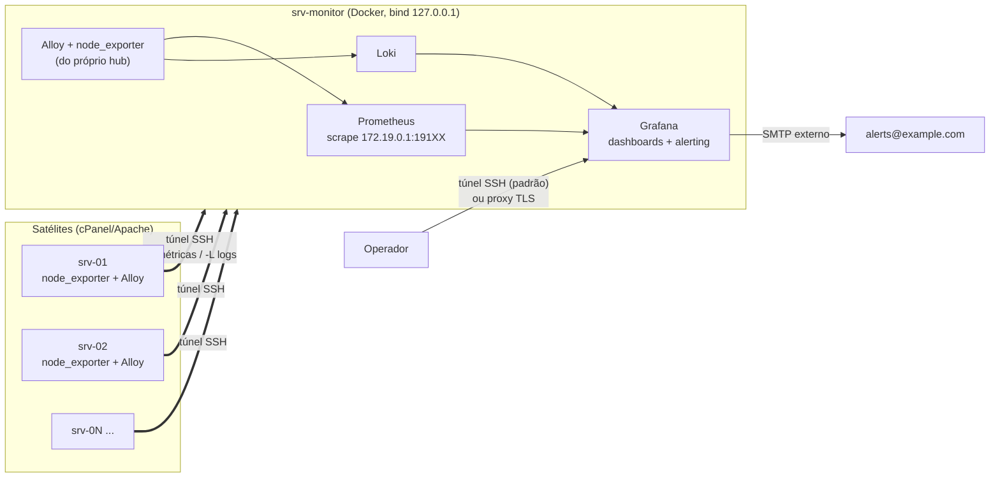

# linux-observability-stack

Stack de observabilidade para uma frota de servidores Linux com cPanel/Apache: métricas, logs centralizados, dashboards e alertas, com **nenhuma porta nova exposta na internet**.

Grafana · Prometheus · Loki · Grafana Alloy · Node Exporter

Este repositório é a versão anonimizada e didática de um ambiente que implantei em produção, em fases, para uma frota de servidores de hospedagem. Os nomes de servidores, endereços e domínios são fictícios (`srv-monitor`, `srv-01`, `example.com`, faixas de IP de documentação).

## O que é

- **Hub** (`srv-monitor`): Grafana, Prometheus, Loki, Alloy e Node Exporter em Docker Compose, todas as portas em `127.0.0.1`.
- **Satélites** (`srv-01`, `srv-02`, ...): apenas `node_exporter` e Alloy nativos (systemd), sem Docker.
- **Transporte**: um túnel SSH por satélite, iniciado pelo satélite, com usuário e chave dedicados e restrições no sshd. Métricas sobem por túnel reverso até o gateway da rede Docker do hub; logs descem por túnel local até o Loki.
- **Logs classificados na coleta** com o label `categoria` (autenticação, firewall, web, e-mail, etc.), descarte de ruído na origem e coleta opt-in de access logs do Apache por domínio.
- **Alertas** de servidor offline, CPU, memória e disco, por e-mail via SMTP externo.



Detalhes em [docs/arquitetura.md](docs/arquitetura.md).

## Estrutura

```
.
├── docker-compose.yml            # stack do hub (versões fixadas)
├── .env.example                  # segredos e SMTP (copiar para .env)
├── prometheus/prometheus.yml     # hub + satélites via túnel
├── loki/loki-config.yml          # single-binary, retenção 15 dias
├── alloy/
│   ├── hub.alloy                 # Docker + journal do hub, filtros de ruído
│   └── agent.alloy               # satélite: journal + categoria + domlogs opt-in
├── grafana/
│   ├── provisioning/
│   │   ├── datasources/          # Prometheus e Loki (uids fixos)
│   │   ├── dashboards/           # provider por estrutura de pastas
│   │   └── alerting/             # regras, contact point, política
│   └── dashboards/
│       ├── infra/visao-geral.json
│       └── operacao/logs-eventos.json
├── agent/
│   ├── systemd/                  # node_exporter e monitoring-tunnel
│   ├── ssh/                      # Match User para o usuário de túnel
│   └── firewall/                 # exemplos de regras CSF
├── scripts/                      # healthcheck, métrica textfile, ACL de domlogs
└── docs/                         # arquitetura, rollout, decisões, queries
```

## Quick start (hub)

Pré-requisitos: Docker Engine + Compose v2; portas 3000, 9090, 3100, 9100 e 12345 livres em loopback; subnet `172.19.0.0/16` sem conflito no host.

```bash
git clone https://github.com/<usuario>/linux-observability-stack.git
cd linux-observability-stack

cp .env.example .env
chmod 600 .env
# edite .env: GF_ADMIN_USER, GF_ADMIN_PASSWORD, SMTP e ALERT_EMAIL

mkdir -p node-exporter-textfile

# opcional: dashboard comunitário "Node Exporter Full" (ID 1860)
./scripts/fetch-node-exporter-full.sh

docker compose up -d
./scripts/healthcheck.sh
```

Para testar só o hub, comente os jobs `node-exporter-srv-*` em `prometheus/prometheus.yml` (sem satélites eles ficam `down` e disparam "Servidor offline").

Acesso ao Grafana:

```bash
ssh -L 3000:localhost:3000 <usuario>@srv-monitor.example.com
# abra http://localhost:3000
```

## Como adicionar um servidor

Resumo (passo a passo completo em [docs/adicionar-servidor.md](docs/adicionar-servidor.md)):

1. **Probe** somente leitura no satélite, incluindo `nc -zv <hub> <porta-ssh>` para testar a saída pelo firewall.
2. **Hub:** usuário `tunnel-srv-0N` com senha `*`, shell `/bin/true`, chave ed25519 dedicada e bloco `Match User` (`agent/ssh/`).
3. **Hub:** job `node-exporter-srv-0N` no `prometheus.yml` apontando para `172.19.0.1:<próxima porta da faixa 19100-19110>` e `instance` igual ao `host` do Alloy.
4. **Satélite:** `node_exporter` em `127.0.0.1:9100`, Alloy com `alloy/agent.alloy` (ajuste o `host`), serviço `monitoring-tunnel` com `Restart=always`.
5. **Verificação:** alvo `up`, logs com `{host="srv-0N"}` no Loki, teste de resiliência derrubando o túnel, serviços do servidor intactos.

## Alertas e limiares

Provisionados em `grafana/provisioning/alerting/rules-infra.yml`, avaliados a cada 1 minuto e **por servidor** (`instance`):

| Regra | Condição | `for` | Severidade |
|---|---|---|---|
| Servidor offline | `up{job=~"node-exporter.*"} < 1` | 2 min | critical |
| CPU alta | CPU > 85% | 10 min | warning |
| Memória alta | memória (via `MemAvailable`) > 85% | 10 min | warning |
| Disco alto | disco `/` > 85% | 15 min | warning |

Notificação: contact point `equipe-infra` (e-mail), agrupamento por pasta + nome do alerta, espera de 30 s, reenvio a cada 3 h.

Os limiares foram mantidos após um ciclo de calibração com dados reais da frota. A janela `for` é o que impede falso positivo, por exemplo, no pico artificial de CPU que aparece ao reiniciar o `node_exporter`. Os dashboards usam 70% (atenção) e 85% (crítico) como faixas de cor. Alertas baseados em log ficaram documentados, mas não provisionados ([docs/paineis-e-queries.md](docs/paineis-e-queries.md)).

O pipeline foi validado ponta a ponta parando o `node_exporter` de um satélite: disparo apenas para aquele servidor, e-mail recebido, resolução notificada após religar.

## Segurança da stack

- **Bind em loopback** para todas as portas do hub; Loki e Prometheus não têm autenticação e nunca devem ser publicados.
- **Túnel iniciado pelo satélite:** nenhuma porta de entrada nova nos satélites; no hub, as portas dos túneis escutam só no gateway da rede Docker e o firewall libera apenas a subnet Docker.
- **Usuário de túnel por servidor:** sem senha válida, sem shell, sem TTY/X11/agent forwarding, `permitopen` restrito ao Loki, chave dedicada (revogação individual).
- **Grafana:** usuário admin renomeado, cadastro e acesso anônimo desligados, permissões por pasta + Team, contas individuais.
- **Segredos só no `.env`** (chmod 600, fora do git). Credenciais que aparecerem em texto claro durante uma investigação devem ser rotacionadas.
- **Princípio do menor acesso na coleta:** access logs só de domínios escolhidos, com ACL de leitura nos arquivos específicos.
- **Versões fixadas** no compose; atualize de forma deliberada e teste por alguns dias.

Se o Grafana precisar ser acessado fora do túnel, veja os controles mínimos em [docs/decisoes-e-licoes.md](docs/decisoes-e-licoes.md#2-exposição-do-grafana-só-com-controles).

## Lições aprendidas

Resumo; lista completa em [docs/decisoes-e-licoes.md](docs/decisoes-e-licoes.md).

- Grafana e Loki com 256/512 MB tomaram OOM kill a partir do quinto dia; 1 GB cada resolveu. **Teste por vários dias**, não só no primeiro.
- `session-*.scope` do systemd (uma unidade por login SSH) estoura o limite de streams do Loki. Filtre na origem.
- `csf -r` apaga as regras de iptables do Docker. Libere uma **faixa** de portas uma única vez.
- Firewall com política de **saída** restritiva faz o `ssh-keyscan` falhar em silêncio. Teste a conectividade antes de configurar.
- Dashboards do Grafana têm permissões próprias que **se somam** às da pasta. Teste com um usuário sem Team.
- O `detected_level` do Loki não classifica bloqueios de firewall; classifique na coleta.
- `5[0-9]{2}` não funcionou na combinação usada em LogQL; `5[0-9][0-9]` sim. Valide queries com dados reais.
- Um único serviço ruidoso pode dominar o contador de erros da frota inteira e esconder o resto.

Rollout completo (laboratório → expansão → dashboards/alertas → calibração) em [docs/rollout-fases.md](docs/rollout-fases.md).

## Versões

| Componente | Versão |
|---|---|
| Grafana | 13.1.1 |
| Prometheus | v3.5.0 |
| Loki | 3.5.0 |
| Grafana Alloy | v1.18.0 |
| Node Exporter | v1.12.1 |

Use as mesmas versões de `node_exporter` e Alloy nos satélites.

## Licença

[MIT](LICENSE) © 2026 Lygia Teixeira
