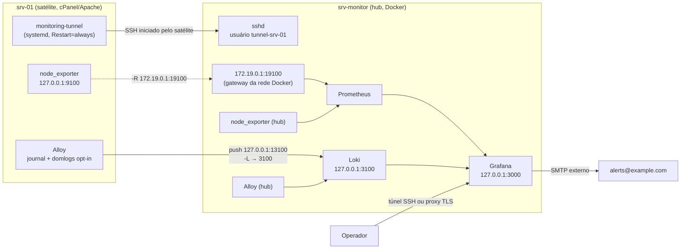

# Arquitetura

## Visão geral: modelo hub

Um único servidor (`srv-monitor`) roda a stack completa em Docker. Os demais servidores (`srv-01`, `srv-02`, ...) são **satélites**: recebem apenas dois agentes nativos (`node_exporter` e Grafana Alloy) como serviços systemd, sem Docker.

## Por que hub e não stack completa em cada servidor

| Stack completa por servidor | Modelo hub (adotado) |
|---|---|
| Grafana/Prometheus/Loki em cada servidor | Uma única central para todos |
| Um dashboard por servidor, sem visão unificada | Um dashboard com todos os servidores lado a lado |
| 5 containers por servidor | 2 agentes nativos por satélite |
| Exige Docker em todos | Satélites não precisam de Docker |

Nos satélites, instalar um runtime de container só para dois agentes adicionaria um componente novo de infraestrutura em servidores de produção. Binários nativos têm menor pegada.

## Conexão: túnel SSH iniciado pelo satélite

Nenhuma porta pública nova é aberta em nenhum dos lados. Cada satélite mantém um túnel SSH persistente **para** o hub:

- `-L 127.0.0.1:13100:127.0.0.1:3100` — o Alloy do satélite envia logs para `http://127.0.0.1:13100/loki/api/v1/push`, que chega ao Loki do hub.
- `-R 172.19.0.1:191XX:127.0.0.1:9100` — o sshd do hub escuta na porta `191XX` **somente** no gateway da rede Docker (`172.19.0.1`), inalcançável pela internet, e encaminha para o `node_exporter` do satélite. O Prometheus faz scrape desse endereço como se fosse um alvo local.

Controles no hub (ver `agent/ssh/sshd_config-tunnel.example`):

- um usuário Linux por satélite (`tunnel-srv-01`), sem senha válida e sem shell interativo;
- uma chave ed25519 exclusiva por túnel (a privada fica só no satélite);
- bloco `Match User` com `AllowTcpForwarding yes`, `GatewayPorts clientspecified`, sem TTY, sem X11, sem agent forwarding;
- firewall liberando a faixa `19100-19110` **apenas** para a subnet Docker `172.19.0.0/16`.

> Em OpenSSH anterior a 8.7 não existe `PermitListen`. A mitigação usada foi fazer o bind remoto no gateway interno do Docker (não roteável externamente) e restringir o acesso pelo firewall. Com sshd 8.7+, adicione `PermitListen` para travar a porta de cada usuário.

O `docker-compose.yml` fixa a subnet `172.19.0.0/16` e o gateway `172.19.0.1`; sem isso, recriar a rede poderia mudar o endereço e quebrar todos os scrapes.

## Tabela de portas

| Porta | Onde | Bind | Uso |
|---|---|---|---|
| 3000 | hub | 127.0.0.1 | Grafana |
| 9090 | hub | 127.0.0.1 | Prometheus |
| 3100 | hub | 127.0.0.1 | Loki (push e query) |
| 9100 | hub | 127.0.0.1 | node_exporter do hub |
| 12345 | hub | 127.0.0.1 | UI/debug do Alloy |
| 19100-19110 | hub | 172.19.0.1 | túneis reversos (um por satélite) |
| 9100 | satélite | 127.0.0.1 | node_exporter |
| 13100 | satélite | 127.0.0.1 | ponta local do túnel para o Loki |

## Identidade dos servidores

O mesmo nome é usado em dois lugares e precisa coincidir:

- `instance` no `prometheus/prometheus.yml` (métricas);
- `host` no `alloy/agent.alloy` (logs).

Isso permite correlacionar métricas e logs do mesmo servidor no Grafana.

## Logs: fontes e classificação

| Fonte | Onde | Observação |
|---|---|---|
| Journal do systemd | hub e satélites | descarta `session-*.scope` e `*.mount` (cardinalidade) |
| Containers Docker | hub | labels `container` e `container_id`; containers legados excluídos |
| Access logs do Apache por domínio | satélites, opt-in | label `dominio`; leitura via ACL só nos arquivos escolhidos |

O label `categoria` é atribuído **no Alloy, antes do Loki**, a partir do `unit` do systemd e, como fallback, de padrões de texto (bloqueios de firewall chegam ao journal sem unit própria). Categorias: `sistema` (padrão), `autenticacao`, `web`, `php`, `banco`, `email`, `arquivos`, `firewall`, `seguranca`, `aplicacao`, `monitoramento`.

Limitação conhecida: `httpd`, `mysqld` e `php-fpm` costumam logar em arquivo, não no journal. Por isso `web`, `banco` e `php` ficam esparsas; a coleta opt-in de domlogs cobre parcialmente a categoria `web`.

## Retenção e recursos

- Prometheus: 15 dias (`PROMETHEUS_RETENTION`).
- Loki: 15 dias (`retention_period: 360h`, via compactor).
- Limites de recursos no hub (soma aproximada de 2,4 vCPU / 2,9 GB). Grafana e Loki com 1 GB cada; valores menores causaram reinícios por OOM killer após alguns dias de operação.
